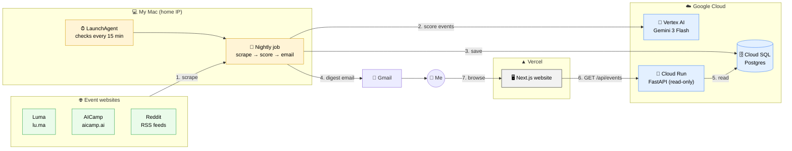
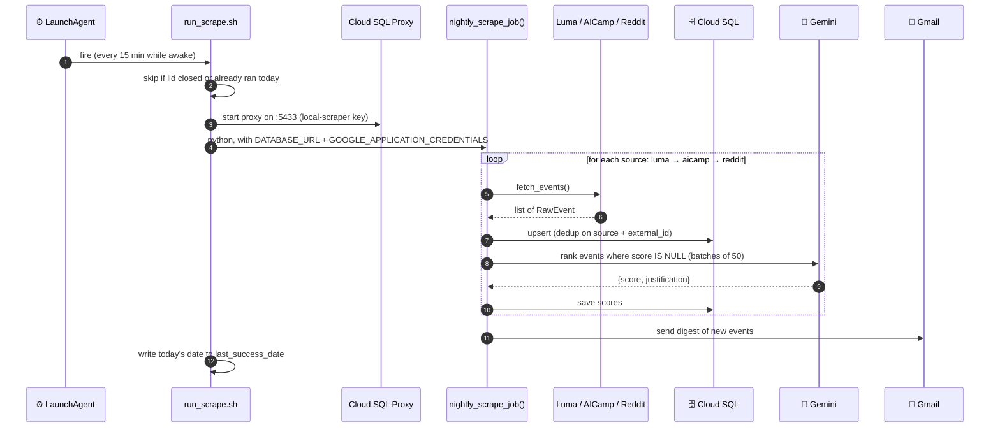
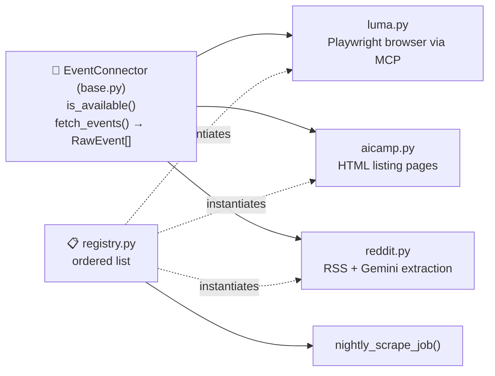
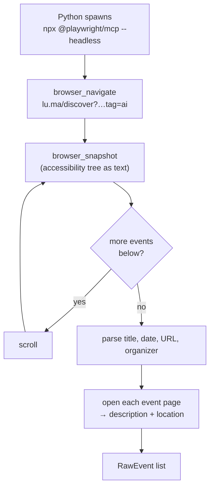
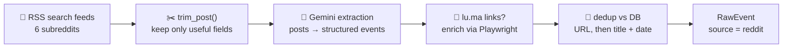
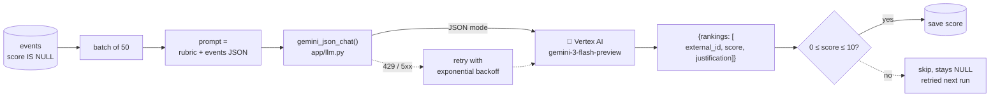
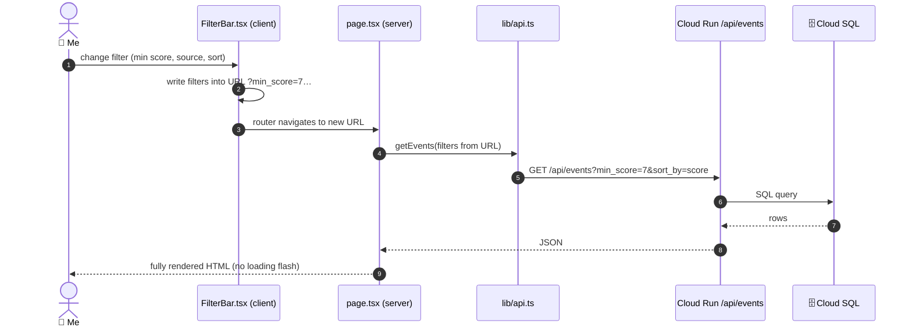
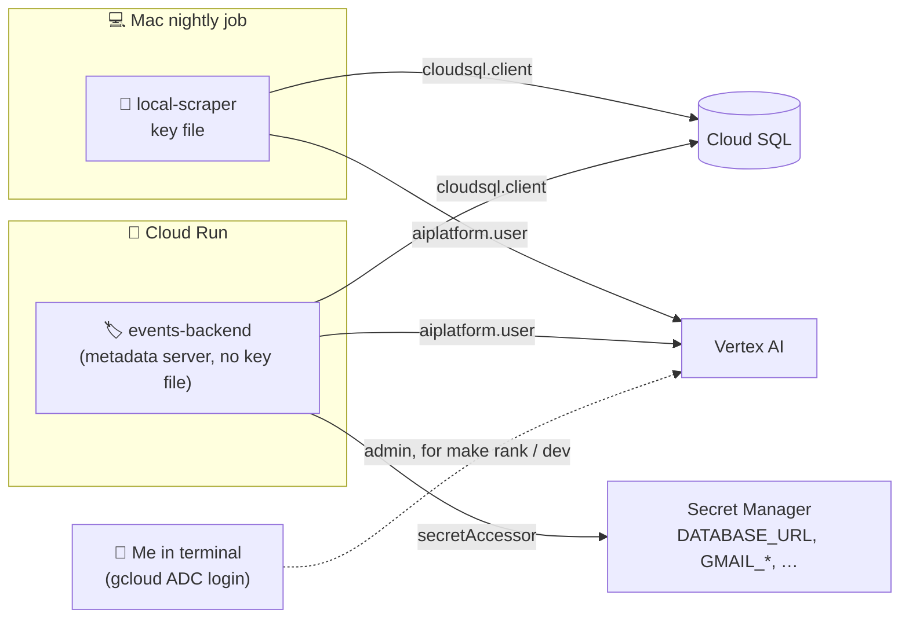

# Events Finder: Architecture Map

> **Updated 2026-11-17.** Read top to bottom: big picture → nightly job → one source in depth → AI scoring → website → security.

**In one line:** every night my Mac collects Bay Area AI events from Luma, AICamp and Reddit. Gemini scores each one 0–10 for how useful it is to an AI engineer, and a website shows the best ones first.

---

## 1. The big picture

**In plain words:**
1. My **Mac** does the scraping. Luma and Reddit block Google Cloud's datacenter IPs, so it has to come from a home IP.
2. The Mac sends new events to **Gemini on Vertex AI**, which returns a score and a one-line reason.
3. Everything is saved in **Cloud SQL** (Postgres).
4. I get a **Gmail digest** of what's new.
5. **Cloud Run** only *reads* the database. It never scrapes or calls the AI.
6. The **Vercel** website asks Cloud Run for events and renders them.

> 💡 **Interview line:** "I split *collection* from *serving*. Scraping runs locally on a residential IP because event sites block cloud IPs; the cloud side is serve-only, scales to zero and costs almost nothing."

---

## 2. What happens every night

**Key details:**
- **Upsert, not insert.** The same event seen again gets *updated*. If its title or description changed, its score is reset to `NULL` so it's re-scored.
- **Only unscored events go to Gemini**, so most nights cost almost nothing.
- **One failing source doesn't stop the others.** Each source has its own `ScrapeRun` row with status `success`/`failed`.
- **Why "every 15 min" and not 2am:** with the laptop lid closed the Mac sleeps mid-run and the database connection dies. Now it runs once a day, whenever the lid is open. The wrapper skips cheaply if the lid is closed or today already succeeded.
- **Why 15 min and not 2h:** launchd's `StartInterval` timer only counts *awake* time and does not fire on wake. With a 2h interval, the first run after opening the lid could be hours away (it missed the morning of 2026-11-17). `RunAtLoad` only fires at login/reload.

---

## 3. Sources are plug-ins (connector pattern)

- Every source implements the same two methods, so the rest of the app (job, ranker, API, website) never changes.
- **Adding a source = one new file + one line in `registry.py`.**
- `is_available()` lets a source skip itself (for example if Playwright isn't installed) instead of crashing the run.
- **Order matters:** Reddit runs last so it can drop events Luma/AICamp already saved.

### Luma in depth (the trickiest one)

Luma has no public API, so the app drives a real Chromium browser through the **Model Context Protocol (MCP)** Playwright server.

### Reddit in depth

⚠️ Reddit currently returns HTTP 403 on its search feeds, so most events come from Luma and AICamp.

---

## 4. How AI scoring works

| Score | Meaning |
|---|---|
| **9–10** | Agentic AI / multi-agent systems in production / AI engineering careers |
| **7–8** | LLM engineering, AI infra, production deployment, agent frameworks |
| **5–6** | General AI/ML engineering |
| **0–4** | Not relevant |
| **+0.5–1** | Bonus if it enables 1:1 networking with AI engineers or hiring managers |

- **One door to the LLM:** the ranker, the Reddit extractor and the evals all call `gemini_json_chat()`. Switching providers (Groq → Gemini, Nov 2026) meant changing that one file.
- **Evals:** `backend/evals/eval_ranker.py` runs the real ranker on a hand-labeled golden dataset in **LangSmith**. Checks: score inside the expected band, how far off it was, justification format, and an **LLM-as-judge** (`gemini-3.1-pro-preview`) that checks the justification is grounded in the event text.
- The ranker sends the **full description** (`short_description` is only a 400-char display snippet) and only scores **upcoming** events, so past or repeatedly-skipped events aren't re-sent every night.

---

## 5. The website (request flow)

- **Filters live in the URL.** Links are shareable, and the server renders the right list on first load (SSR).
- Click a card → `app/events/[id]/page.tsx` → `GET /api/events/{id}`.

---

## 6. Who is allowed to do what (identities)

| Who | Runs as | How it gets a token |
|---|---|---|
| Nightly scrape (Mac) | `local-scraper` service account | Private key in `~/.config/events-finder/` → signed JWT → access token |
| Cloud Run backend | `events-backend` service account | Metadata server (nothing stored on disk) |
| Me running `make rank` | My Google account | ADC refresh token from `gcloud auth application-default login` |

**Least privilege:** each service account has only the roles it needs. No API keys exist for the AI; Vertex uses Google identity.

---

## 7. Where things live

| Path | Job |
|---|---|
| `backend/app/main.py` | FastAPI app, CORS, starts the scheduler (disabled on Cloud Run) |
| `backend/app/scheduler/jobs.py` | `nightly_scrape_job()` and `upsert_events()`, the heart of the pipeline |
| `backend/app/connectors/` | One file per source + `base.py` (interface) + `registry.py` (list) |
| `backend/app/llm.py` | `get_client()` + `gemini_json_chat()`, the only place that talks to Gemini |
| `backend/app/ranking/event_ranker.py` | Scoring rubric prompt + batch ranking |
| `backend/app/notifications/email.py` | Gmail digest (SMTP) |
| `backend/app/api/events.py` | `GET /api/events`, `GET /api/events/{id}` |
| `backend/app/api/admin.py` | `/health`, `/scrape/runs`, `/scrape/trigger` (secret-protected) |
| `backend/app/models.py` | Tables: `Event`, `ScrapeRun` |
| `backend/app/config.py` | All settings, read from `.env` / env vars |
| `backend/evals/` | LangSmith eval + golden dataset |
| `frontend/app/page.tsx` | Home feed (server component) |
| `frontend/components/` | `FilterBar`, `EventCard`, `ScoreBar` |
| `frontend/lib/api.ts` | `getEvents()` / `getEvent()` fetch helpers |
| `~/.config/events-finder/run_scrape.sh` | Mac wrapper: guards, proxy, credentials, runs the job (not in git) |

---

## 8. How to…

| I want to… | Do this |
|---|---|
| Run the scrape now (local) | `cd backend && make scrape` |
| Re-score unscored events | `cd backend && make rank` |
| See if the nightly run worked | `tail -50 ~/.config/events-finder/scrape.log` |
| Add a new event source | New file in `connectors/` implementing `EventConnector` + one line in `registry.py` |
| Change the AI model | `GEMINI_MODEL=…` in `backend/.env` |
| Change the scoring rules | Edit `SYSTEM_PROMPT` in `event_ranker.py`, then run the eval |
| Deploy backend code | `cd backend && gcloud builds submit --tag …` then `gcloud run deploy events-backend --image …` |
| Check what's live on Cloud Run | `gcloud run revisions list --service events-backend --region us-central1` |

---

## 9. Two-minute interview pitch

1. **Problem:** AI events are scattered across Luma, AICamp and Reddit, and most aren't relevant to an AI engineer.
2. **Collection:** pluggable connectors. Luma has no API, so I drive a headless browser through **MCP + Playwright**. Reddit posts are unstructured, so an **LLM extracts** events from them.
3. **Ranking:** **Gemini on Vertex AI** with JSON-mode structured output and a rubric prompt, in batches, with retry/backoff. Only new or changed events are scored.
4. **Quality:** a **LangSmith eval** with a golden dataset, band-based metrics and an **LLM-as-judge** on a different model.
5. **Infra:** collection runs **locally** (residential IP beats bot blocking) → **Cloud SQL** ← **Cloud Run** (serve-only, scale-to-zero) ← **Vercel** Next.js with SSR and URL-driven filters. Least-privilege service accounts, no AI API keys.
